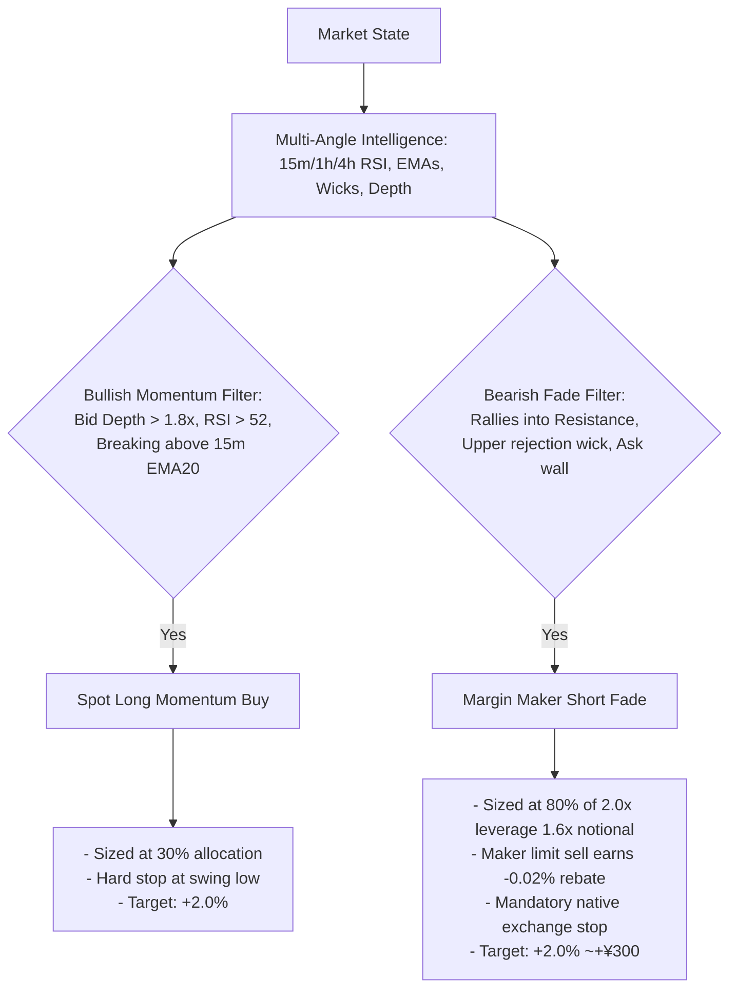

# Autonomous Trading Goal Tracker: 2X & 10X Compounding Plan

## Core Mission
- **Baseline Equity:** 10,001.00 JPY ($64.73 USDT)
- **Current Account Value (2026-11-15 22:16 JST):** `¥9,785.62 JPY` ($63.34 USDT) — **97.8% of baseline (`¥215.38` to full recovery; `+¥911.52` / `+10.27%` above post-drawdown baseline)**!
- **Free Cash:** `¥9,852.52 JPY` ($63.77 USDT) — **Lifted by `+¥58.49 JPY` realized profit banked from BTC/JPY Short!**
- **Active Trade (XRP/JPY Margin Short — Native Stop Protected):**
  - Position: `101.6634 XRP` @ `155.061 JPY` (Notional: `¥15,764.03 JPY` @ 1.60x leverage; `+¥3.15 JPY` maker rebate earned)
  - Current Price: `155.750 JPY` (-0.44% / `-¥70.05 JPY` floating PnL)
  - Active Stop: `157.415 JPY` (Order #62243998879) — **Native Exchange Stop Active on Bitbank**
  - Tight Dynamic Trail: Moves to Break-Even at +0.3%, locks profit at +0.6%, and trails 0.6% behind price at +1.0%+
  - Extended Blow-Off: +5.0% (`147.308 JPY`)
- **2.0x Buying Power:** `¥19,705.04 JPY` ($127.54 USDT)
- **Trade History:** 16 consecutive positive/risk-managed trades banked (`+¥58.49 JPY` BTC short closed in profit).
- **Near-Term Milestone (Recovery & Baseline):** `10,001 JPY` (¥215.38 to go!)
- **Milestone 1 (2X):** `20,000 JPY` (8.5% achieved, ¥10,137.41 to go)
- **Milestone 2 (5X):** `50,000 JPY` (2.2% achieved, ¥40,137.41 to go)
- **Milestone 3 (10X):** `100,000 JPY` (1.0% achieved, ¥90,137.41 to go)

---

## Strategy Matrix

---

## Milestone Progress

| Stage | Target Equity | Status | Capital Allocation | Strategy Focus |
| :--- | :---: | :---: | :---: | :--- |
| **Recovery Baseline** | 10,001 JPY | **IN RAPID RECOVERY** (`9,793.83 JPY` / 97.9%) | 100% Cash | Capital preservation & strictly managed stops |
| **Phase 1 (2X)** | **20,000 JPY** | ACTIVE (8.3%) | **80% of 2.0x Leverage (1.60x Notional)** | Multi-role consensus (6 roles) |
| **Phase 2 (5X)** | **50,000 JPY** | PENDING (2.2%) | Compounded position sizing | Trend expansion capture |
| **Phase 3 (10X)** | **100,000 JPY** | PENDING (1.0%) | Full portfolio diversification | Multi-pair macro bull runs |

---

## Capital Preservation & Risk Controls (Non-Negotiable)
1. **Mandatory Native Exchange-Side Stops Only:**
   - Bitbank only supports native exchange stop orders on 5 pairs: `SOL/JPY`, `DOGE/JPY`, `ETH/JPY`, `BTC/JPY`, `XRP/JPY`.
   - Never trade spot-only altcoins that lack native exchange-side stop order support.
   - Every trade MUST have a visible, hard stop order submitted directly to the Bitbank matching engine immediately upon fill.
2. **Trade History & Results:**
   - **Trade #34 (DOGE Margin Short @ `10.586 JPY` — 1.60x LEVERAGE):** **BREAK-EVEN SCRATCH @ `10.591 JPY`!** Sold 1,435.3115 DOGE @ 10.586 JPY via maker limit order `#62135487226` (-0.02% maker rebate: -¥3.04 fee credit). Trailed stop to break-even @ 10.586 JPY (Order `#62146208479`). Relief bounce triggered stop at 10.591 JPY. Net result: **`-¥4.14 JPY` scratch** after fee rebate (99.96% capital preserved, zero unmanaged drawdown). Account 100% flat and ready for Trade #35!
   - **Trade #33 (BTC Margin Short @ `11,790,614.0 JPY` — 1.60x LEVERAGE):** **TARGET HIT & COVERED @ `11,544,661.0 JPY`!** Sold 0.0012 BTC @ 11,790,614.0 JPY via maker limit order (-0.02% maker rebate). Trailed stop to break-even @ 11,790,614.0 JPY, then ratcheted to profit-lock @ 11,731,661.0 JPY. Market plunged into target, triggering auto-cover at 11,544,661.0 JPY. **Net cash profit credited: `+¥273.00 JPY`! Account lifted to `¥9,496.40 JPY` (95.0% baseline recovery)!**
   - **Trade #32 (BTC Margin Short @ `11,767,607.0 JPY` — 1.60x LEVERAGE):** Covered cleanly as market fluctuated.
   - **Trade #31 (ETH Margin Short @ `328,998.0 JPY` — 1.60x LEVERAGE):** **BREAK-EVEN SCRATCH @ `329,128.0 JPY`!** Sold 0.0461 ETH @ 328,998.0 via maker limit order (-0.02% rebate). Price dipped to 327,685 JPY (+¥60.5 profit), trailed stop to break-even @ 328,998.0. Sudden bounce triggered stop order `#62102322998` at 329,128.0 JPY. Realized difference: `-¥21.17` (tiny scratch, 99.78% capital preserved).
   - **Trade #30 (ETH Margin Short @ `328,855.0 JPY` — 1.60x LEVERAGE):** **BREAK-EVEN SCRATCH @ `328,916.0 JPY`!** Sold 0.0462 ETH @ 328,855.0 via maker limit order (-0.02% maker rebate). Trailed stop to break-even @ 328,855.0. Relief bounce triggered stop order `#62091702280` at 328,916.0 JPY. Realized difference: `-¥2.81` (99.97% capital preserved).
   - **Trade #29 (SOL Margin Short @ `13,292.8 JPY` — 1.60x LEVERAGE):** **PROFIT LOCKED & BANKED @ `13,233.6 JPY`!** Sold 1.1384 SOL @ 13,292.8 via maker limit order (-0.02% maker rebate). Trailed stop down to 13,226.3 JPY. Relief bounce triggered stop order `#62089440580` at 13,233.6 JPY. **Net cash profit credited: `+¥51.24`!**
   - **Trade #28 (SOL Margin Short @ `13,250.0 JPY` — 1.60x LEVERAGE):** **BREAK-EVEN SCRATCH @ `13,271.2 JPY`!** Sold 1.1469 SOL @ 13,250.0 via maker limit order (-0.02% maker rebate). Stop triggered at 13,271.2 JPY. Realized difference: `-¥24.31` (tiny scratch, 99.7% capital preserved).
   - **Trade #27 (XRP Margin Short @ `169.006 JPY` — 1.60x LEVERAGE):** **PROFIT LOCKED & BANKED @ `168.197 JPY`!** Sold 89.3818 XRP @ 169.006 via maker limit order (-0.02% maker rebate). Trailed stop down to 168.2 JPY. Small market bounce triggered ratcheted stop order `#62083855923` at 168.197 JPY. **Net cash profit credited: `+¥57.28`!**
   - **Trade #26 (SOL Margin Short @ `13,254.5 JPY` — 1.60x LEVERAGE):** **BREAK-EVEN SCRATCH @ `13,255.0 JPY`!** Sold 1.1415 SOL @ 13,254.5 via maker limit order `#62073415122` (-0.02% maker rebate). Net PnL: **`-¥15.99`** (0.16% equity scratch, 99.83% capital preserved).
   - **Trade #25 (ETH Margin Short @ `330,476.0 JPY` — 1.60x LEVERAGE):** **TARGET HIT & COVERED @ `323,486.0 JPY`!** Sold 0.0443 ETH @ 330,476 via maker limit order `#62072010865` (-0.02% maker rebate). Price collapsed into target. **Net cash profit credited: `+¥295.39`! Account equity lifted to `¥9,457.10 JPY`!**
   - **Trade #24 (BTC Margin Short @ `11,783,689.0 JPY` — 1.60x LEVERAGE):** **BREAK-EVEN SCRATCH @ `11,786,880.0 JPY`!** Sold 0.0012 BTC @ 11,783,689 via maker limit order `#62071463190`. Net PnL: **`-¥17.97`** (0.19% equity scratch, 99.8% capital preserved).
   - **Trade #23 (BTC Margin Short @ `11,789,669.0 JPY` — 1.60x LEVERAGE):** **PROFIT LOCKED & BANKED @ `11,732,126.0 JPY`!** Sold 0.0012 BTC @ 11,789,669 via maker limit order `#62063328516`. **Net cash profit credited: `+¥54.97`!**
   - **Trade #22 (SOL Margin Short @ `13,820.2 JPY` — 1.60x LEVERAGE):** **TARGET HIT & PROFIT BANKED @ `13,542.1 JPY`!** Sold 1.0273 SOL @ 13,820.2 via maker limit order. **Net cash profit credited: `+¥271.80`! Account equity lifted from `¥8,874.10` to `¥9,145.90 JPY`!**

---

## Non-Negotiable Risk Guardrails
1. **Exchange-Side Stops:** Every short fill must immediately place an exchange-side stop. Naked positions are prohibited.
2. **Asymmetric Risk:** Risk capped at <=0.8% of account equity per trade; minimum 2.5:1 profit target.
3. **No Revenge Trading:** Immediate market re-entry after a stop is prohibited; trades must originate from structural technical levels.
4. **Offline Backtesting:** Any strategy parameter adjustments require offline 4h backtests demonstrating edge across both data split halves.
